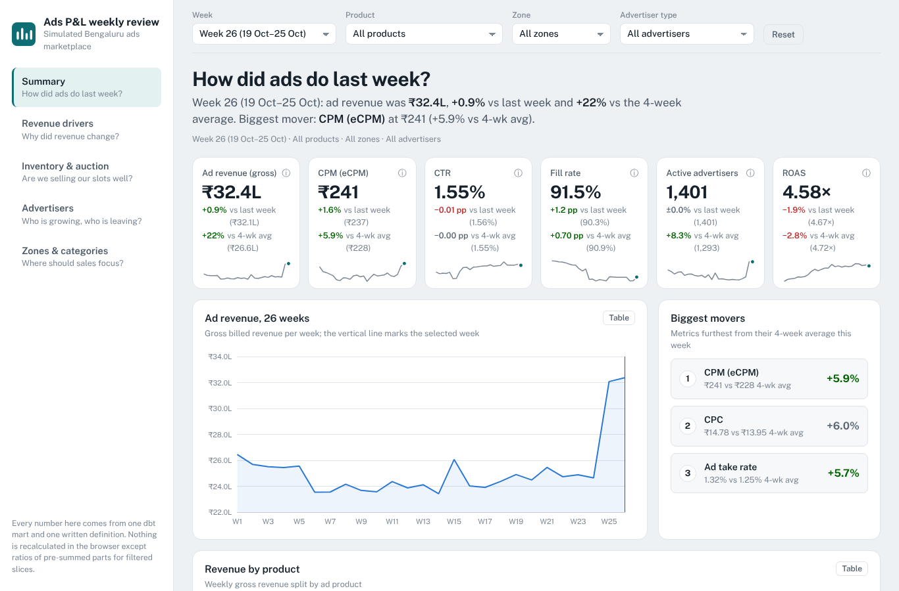
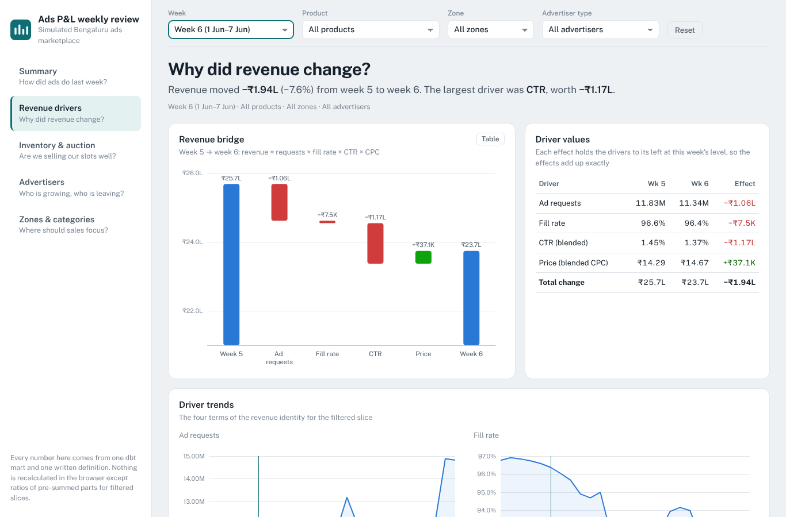
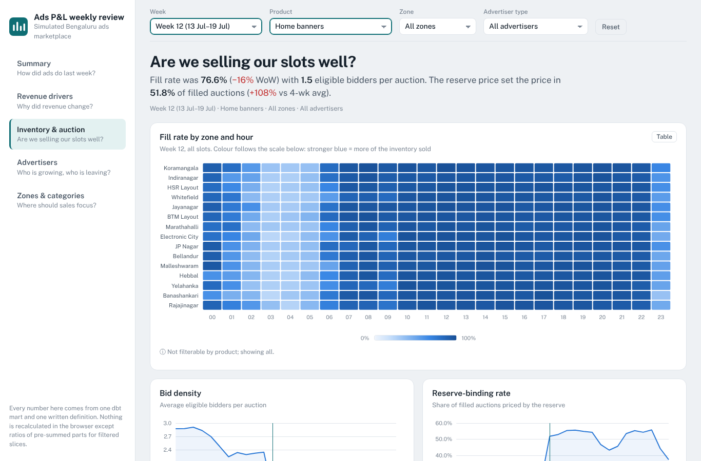
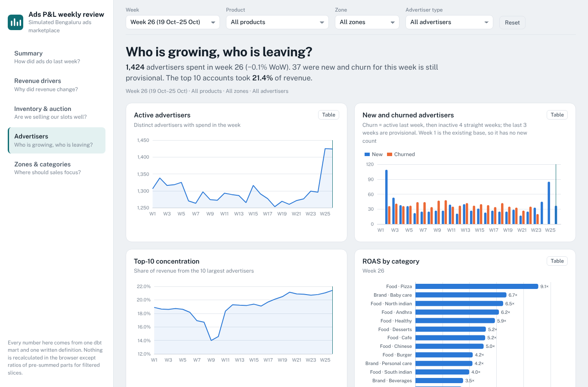
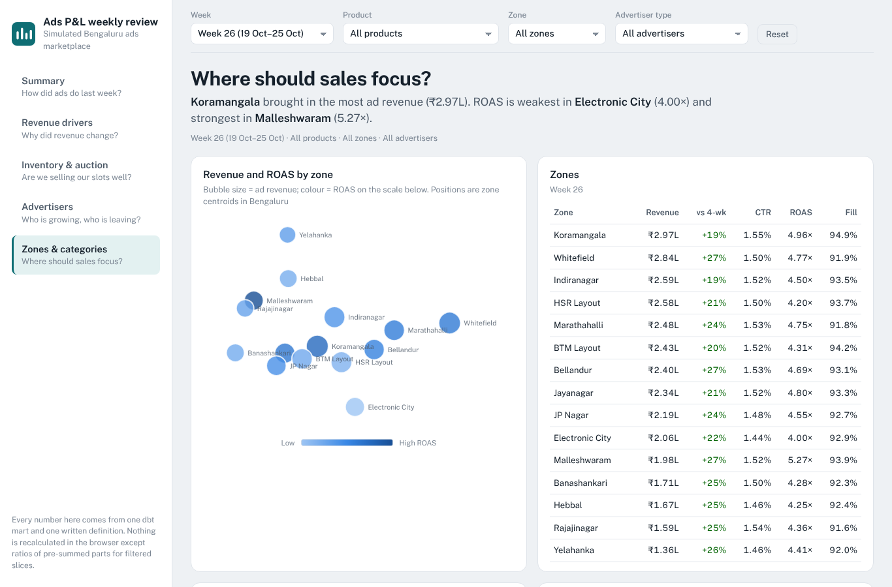

# Ads P&L Dashboard — weekly ads reporting for a simulated Bengaluru marketplace

> **All data in this project is simulated.** It is not Swiggy data. Restaurant and brand names come from
> public Kaggle datasets (Zomato Bangalore, BigBasket) for realism only; every ad metric attached to them is invented.

**Live dashboard:** http://vivekbuilds.me/swiggy-ads-pnl/ · **Metric dictionary + lineage:** http://vivekbuilds.me/swiggy-ads-pnl/docs/ · **WBR memos:** [`reports/`](reports/) · **Variance model (Google Sheets):** see [`sheets/`](sheets/) · **Showcase kit:** [`docs/showcase.md`](docs/showcase.md)

The weekly ads P&L reporting an ads team runs every Monday, built end to end: a seeded marketplace simulator →
a layered SQL warehouse (dbt on DuckDB, BigQuery-ready) → one tested metric layer → a 5-page dashboard → one-page
weekly business reviews that explain *why* a number moved and *what to do*.



## Key findings (from the WBRs)

Seven events were planted in the simulator with a hidden answer key; each WBR finds its event from the data alone.

| Week | What the data showed | Root cause found | Impact | Memo |
|---|---|---|---|---|
| 6 | Revenue −7.9%; CTR −0.08 pp | Half post-IPL traffic (seasonal); half a **rate** drop isolated to **Android slot 1** (2.36% → 1.38%) → app release | −₹1.35 L/week until hotfix | [WBR 6](reports/wbr_week_06.md) |
| 9 | Instamart revenue −5.3%, top-10 share 16.9% → 14.0% | Largest Instamart brand **paused all campaigns**; thin categories (frozen, baby care) lost 14 pp fill | −₹0.48 L/week; concentration risk | [WBR 9](reports/wbr_week_09.md) |
| 12 | Banner CPM +10% but banner revenue −17.6% | **Reserve +20%** priced out 9 advertisers; fill 84% → 64%, reserve-binding 35% → 57% | −₹0.43 L/week (~₹6 L over the half) | [WBR 12](reports/wbr_week_12.md) |
| 21 | CTR up, Whitefield CVR 10.5% → 8.3% | **Click bot**: 40 IDs, 4,463 clicks, 0 orders | ₹0.57 L billed invalid traffic to credit | [WBR 21](reports/wbr_week_21.md) |
| 24 | CTR 1.36% on one day | **Data, not business**: click log lost 10.1% of events; billing and orders per impression normal | Attribution understated ~8% that day | [WBR 24](reports/wbr_week_24.md) |
| 15, 25–26 | Requests and orders spike | Heavy rain (CTR flat, ROAS up) and the Navratri–Dussehra festive fortnight (+29% revenue, new advertisers ×3) | Seasonality — no action | [notebooks](analysis/) |

## What it answers

| Page | Question a Head of Ads asks on Monday |
|---|---|
| 1. Executive summary | How did ads do last week? (6 JD KPIs vs last week and vs 4-week avg, biggest movers) |
| 2. Revenue drivers | Why did revenue change? (bridge: requests × fill × CTR × CPC) |
| 3. Inventory & auction health | Are we selling our slots well? (fill heatmap, bid density, reserve binding) |
| 4. Advertisers | Who is growing, who is leaving? (new / churned, cohorts, concentration, ROAS by category) |
| 5. Zones & categories | Where should sales focus? (zone map, grow-or-fix quadrant) |

## The marketplace (simulated)

- **Bengaluru, 15 delivery zones**, 26 weeks (27 Apr – 25 Oct 2026), IST, weeks run Monday–Sunday.
- **3 ad products:** food sponsored listings (CPC, positions 1–5), Instamart sponsored products (CPC, positions 1–3, by category), home-screen banners (CPM).
- **~2,300 advertisers** (2,000 restaurants incl. chains, 300 FMCG brands) with budgets, bids, patience and churn.
- **Generalised second-price auctions** with reserve prices, eligibility (delivery radius, category match), budget pacing and opening hours.
- **Behaviour:** CTR by position, hour, quality and ad fatigue; conversion by rating and price band; last-click attribution in the warehouse.
- **Seasonality:** weekday/Friday-night peaks, IPL nights, monsoon rain days, Ganesh Chaturthi, the Navratri–Dussehra festive fortnight.
- **Planted anomalies** with a hidden answer key (`data/answer_key/anomalies.csv`) that no model or chart reads — the WBRs must find them from the data.

## Metric discipline

Every number has **one written definition** ([`dbt/macros/metric_catalogue.sql`](dbt/macros/metric_catalogue.sql)),
**one SQL source** (`kpi_weekly`, built from that catalogue) and **automated tests**. The dashboard never computes a
metric of its own. Ratios sum numerator and denominator first (no average of daily CTRs); the 4-week comparison is a
true 4-week ratio; weekly active advertisers are a weekly distinct count.

| JD metric | Definition |
|---|---|
| Ad revenue | CPC charges + banner impressions ÷ 1,000 × CPM (gross; net = less credits) |
| CPM (eCPM) | ad revenue ÷ impressions × 1,000, across billing types |
| CTR | valid clicks ÷ impressions (double taps within 30 s count once) |
| Fill rate | filled ad requests ÷ ad requests |
| Active advertisers | distinct advertisers with spend > 0 in the week |
| ROAS | attributed GMV ÷ ad spend; last click, same user + advertiser, 24 h window |

Plus 18 supporting metrics (CPC, CVR, bid density, reserve-binding rate, budget utilisation, new/churned
advertisers, ARPA, median spend, top-10 concentration, ad take rate, and a billed-vs-logged click gap that separates
data problems from business problems). **Revenue identity** used in every WBR:
`Ad revenue = Ad requests × Fill rate × CTR × CPC` (banners: `× eCPM ÷ 1,000`).

**Tests** (`dbt build`): unique + not-null keys on every mart grain, accepted values and ranges on every ratio,
`clicks ≤ impressions ≤ ad requests`, revenue reconciles to the raw billing table, net = gross − credits,
no advertiser over budget, no missing dates, the revenue bridge adds up exactly, the KPI cube's roll-ups add up,
and `kpi_weekly` equals the fact tables. Week-over-week moves and click-log gaps raise **warnings**, not failures.

## Architecture

```
simulator (Python, seeded) ──► data/raw/*.csv.gz ──► dbt: staging ─► intermediate ─► marts / reporting ──► dashboard JSON ──► GitHub Pages
  entities · traffic · auction                      (types, dedupe)  (attribution,     (fct_ads_daily,          (5 pages, filters)
  behaviour · lifecycle · anomalies                                   auction outcomes)  kpi_weekly, bridge …)
                                                                                                 └──► dbt docs = metric dictionary
```

Develop on DuckDB; switch to BigQuery with `--target bigquery` (engine-specific SQL lives in
[`dbt/macros/cross_db.sql`](dbt/macros/cross_db.sql)). GitHub Actions rebuilds everything every Monday and on every push.

## Run it

```bash
make setup     # pip install -r requirements.txt && dbt deps
make all       # simulate 26 weeks -> build + test the warehouse -> export dashboard data
make pytest    # simulator unit tests
make sanity    # plausibility report + charts (CTR decays by position, lunch/dinner peaks)
```

One command rebuilds everything from the fixed seed in [`config/sim_config.yaml`](config/sim_config.yaml).
Optional: put the Kaggle files in `data/external/` (see [`data/README.md`](data/README.md)) for real names.

## Repository

```
config/sim_config.yaml     zones, budgets, CTR curves, seed, anomaly schedule
simulator/                 entities · traffic · auction · behaviour · lifecycle · anomalies · run · sanity
dbt/models/                staging → intermediate → marts → reporting (+ schema tests, docs)
dbt/macros/                metric catalogue (the metric dictionary in code), cross-database macros
dbt/tests/                 reconciliation, budget, completeness and warning tests
dashboard/                 export.py (marts → JSON) and the static 5-page site
analysis/                  one notebook per investigation
reports/                   one-page WBR memos
tests/                     pytest for simulator logic
.github/workflows/         weekly refresh + Pages deploy
```

## Screenshots

| Revenue bridge (week 6) | Auction health (week 12, banners) |
|---|---|
|  |  |
| **Advertisers** | **Zones & categories** |
|  |  |

## Numbers at a glance (26 weeks, simulated)

~₹6.5 Cr gross ad revenue · ~310 M ad requests · ~290 M impressions · 4.4 M valid clicks · 0.5 M orders ·
2,300 advertisers (2,000 restaurants, 300 brands) · 24 metrics · 91 dbt tests (89 pass + 2 intended warnings: the festive revenue jump and the tracking-bug day).
